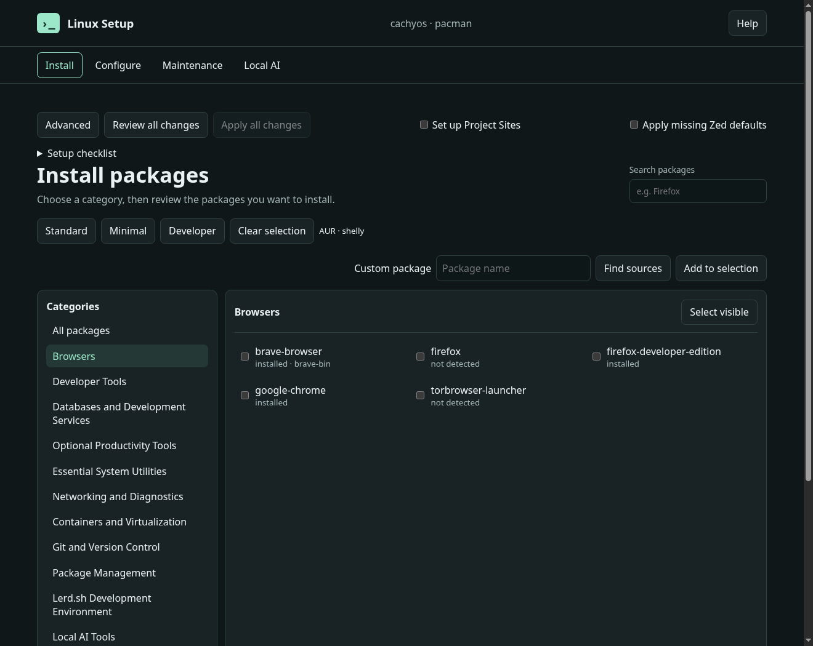

# AI Server Automation v2 — llama.cpp-only upgrade

**Current AI instructions:** [INSTALL-LLAMACPP-FIRST.md](INSTALL-LLAMACPP-FIRST.md). Only llama.cpp is managed for inference; legacy Ollama/vLLM steps below, if any, are archival and not executable via the AI CLI. Other project workflows remain supported.

---

# Linux Automation Toolkit

Use `bash setup.sh` for platform-aware package planning and approved installation.
Python 3.9+ and Bash 4.4+ are required; Bash-only prerequisite bootstrap works before Python is available.

Python handles structured work: package metadata, JSON validation, HTTP checks,
checksums, private receipts and conflict-safe file updates. Its standard library
keeps these consistent across distributions without adding Python dependencies.
Bash remains the entrypoint and pre-Python bootstrap, and invokes native tools.
Using more Python reduces shell quoting and text-parsing risks; it does not
require replacing straightforward shell wrappers.

```bash
bash setup.sh --help
bash setup.sh --check
bash setup.sh packages plan --profile=minimal --dry-run
bash setup.sh packages search git
bash setup.sh packages install --select git,curl,wget,unzip --yes
bash setup.sh wizard
bash setup.sh dashboard open  # graphical package selection and Linux setup
```



The dashboard opens with your distribution, hardware, storage and local AI eligibility. Under Packages, select applications, review the exact package IDs and sources, then proceed with installation or download the plan as JSON. The dashboard reports when sudo authentication or AUR recipe review needs input in the launching terminal. Use Local AI for guided llama.cpp setup and Maintenance for separate toolkit and system cleanup previews. [Dashboard and troubleshooting guide](docs/unified-setup.md#dashboard-review-and-apply)

Installation commands automatically preflight their runtime requirements. `--yes` approves the displayed installation; a noninteractive command without approval refuses changes. Read-only commands and `--dry-run` do not bootstrap packages or write configuration/cache/export files. Gum is optional, with a text fallback.

Configured native repositories are checked for exact package names. Similar names are suggestions only. Unavailable installation selections return exit code 5; they do not become implicitly approved alternatives. No repositories or Flatpak remotes are added. AUR/Shelly require an Arch system and explicit source approval. Immutable hosts and WSL are planning targets by default.

Run `bash setup.sh menu` for the interactive workflow menu or `bash setup.sh --help`
for direct commands.

## Configuration

Safe defaults ship in `config/defaults.env`; the old example file is removed.

```bash
bash setup.sh config show
bash setup.sh config init --yes
```

`config init` creates `.env` with mode 0600 or adds missing settings without changing existing values. Approved package installation can initialize it automatically. Read-only commands use defaults without creating `.env`. Local environment files stay ignored and are never executed or logged. Values are parsed as allowlisted data, never executed.

## Lerd, llama.cpp and local chat

```bash
bash setup.sh lerd status
bash setup.sh ai server plan
bash setup.sh ai server install --dry-run
bash setup.sh chat-lite build --yes
bash setup.sh chat-lite serve --yes
bash setup.sh chat-lite start --yes
bash setup.sh chat-lite debug --port 3002 --yes
bash setup.sh webui status
bash setup.sh webui test
```

Lerd uses its public CLI. The only managed inference engine is llama.cpp
on loopback port 8080. Managed installation uses the distro package manager on supported systemd hosts.
`/srv/ai` can be a local directory or a selected mount. [ChatGPT Lite](chatgpt-lite/README.md)
runs locally on port 3001 by default. Open WebUI is an optional authenticated
client with its own data and a pinned Podman image.
In the dashboard, use **Local AI → Open WebUI** to review installation, start or
stop the container, and test the app. **Local AI → ChatGPT Lite** offers a session
preview and a background service when a systemd user manager is available.

## Zed, package restore and cleanup

```bash
bash setup.sh zed plan
bash setup.sh zed apply --yes
bash setup.sh zed backup --yes
bash setup.sh zed restore BACKUP_ID --dry-run
bash setup.sh packages export --select git,code --output reviewed-packages.json
bash setup.sh packages restore reviewed-packages.json --dry-run
bash setup.sh cleanup plan
bash setup.sh cleanup cache --yes
```

Zed adds missing settings while preserving existing values; an apply creates
a private rollback receipt. Package restore replays exact reviewed native names
on the same platform. Cleanup is limited to expired toolkit repository metadata.
[Workflow details](docs/workflows.md) describe approval and recovery.

## Desktop and updates

```bash
bash setup.sh desktop status
bash setup.sh desktop plan --select firefox.desktop
bash setup.sh desktop apply --select firefox.desktop --yes
bash setup.sh desktop restore BACKUP.json --yes
bash scripts/update.sh --check /path/to/automation-patch.zip
bash scripts/update.sh --apply /path/to/automation-patch.zip
bash scripts/update.sh --rollback
bash scripts/update.sh --recover
bash scripts/update.sh --full-check /path/to/automation-full.zip
```

GNOME/KDE favorites use explicit application IDs and backups, with conflict checks on restore. Other environments are detected and reported unsupported for favorites. Real desktop changes require separate session verification.

Local update ZIPs require checksums and safe manifests, with no signing-key setup or `--allow-unsigned` requirement. Full ZIP upgrades use the same backup/rollback engine. Use the **new release updater** to apply the first migration to an older tree: see [migration](docs/legacy-migration.md). Never overwrite a modified prior release blindly.

## Validation and compatibility

```bash
python3 scripts/validate.py --mode offline
python3 scripts/validate.py --mode containers --engine podman --require-containers
python3 scripts/container_workflows.py --allow-install --with-lint --output /tmp/toolkit-packages
bash setup.sh ai server plan  # read-only llama.cpp planning
```

Container images are not pulled without `--allow-pull`. Package integration installs only into disposable rootless Podman layers. No developer packages, services, databases or model caches are changed. Unit mocks, distro probes, container installs and real-host/GUI/GPU tests are distinct evidence.

See [setup guide](docs/unified-setup.md), [architecture](docs/unified-architecture.md), [setup](docs/unified-setup.md), [documentation index](docs/index.md) and [contributor rules](AGENTS.md).

Project directory creation, Lerd PHP guidance, reviewed USB exports and
rootless Open WebUI lifecycle are described in the [configuration guide](docs/configuration-and-webui.md).
Their verification boundaries are explicit. The opt-in actual app sandbox tests WebUI authentication, recovery and persistence separately from model inference or browser UX.

The legacy installer module is removed. Its maintained replacements and owner-approved retirements are recorded in the [migration ledger](docs/legacy-migration.md). Development runtimes and services use Lerd; existing host data and installations are preserved. The [portable Laravel server toolkit](laravel/README.md) provides independently runnable production provisioning and release deployment. Its own `.env`, helpers, templates, documentation and tests all live in `laravel/`; optional `setup.sh laravel provision|deploy` only delegates to its two entrypoints.

## Developer configuration

```bash
bash setup.sh developer status
bash setup.sh developer git --name "Your Name" --email you@example.com --dry-run
bash setup.sh developer shell --shell fish --dry-run
```

Developer changes require `--yes` (or confirmation), create a private backup and preserve unrelated settings. `developer restore BACKUP.json --yes` refuses to overwrite later edits. No SSH keys, credential stores, login shells, service policies or third-party shell plugins are changed implicitly. This task works locally and produces no new release archives or standalone delivery reports.

Setup checks use `checklist check`; `checklist automate --select configuration,projects --dry-run` previews the existing configuration merge and Project Sites layout, and `--yes` applies only missing steps. The 25 remaining manual tasks use `checklist list`, `checklist review` or `checklist done TASK_ID --yes`; these records are acknowledgements only. Duplicate Git identity/package tasks are replaced by maintained workflow guidance, with old progress preserved. Explicit SSH enrollment uses `developer ssh-generate`, `developer ssh` and `developer ssh-add` with a selected `--identity-file`; existing keys, agents and SSH config are preserved. Old Git backups can be imported into conflict-safe restore receipts. Shell integration includes working vendor-tool functions and an optional installed fetch banner. See the [migration commands and safety boundaries](docs/unified-setup.md#ssh-and-old-git-backups).

Model discovery reads publisher metadata without downloading weights. Use
`ai llamacpp gguf-context FILE` to read trained context metadata, or see
[verified GGUF bundle operations](docs/unified-setup.md#complete-gguf-bundles-and-old-selection-recovery).

GitHub transport rewriting is explicit through `developer git-transport --transport ssh|https`. `developer ssh-agent configure/start/stop/enable/disable/status/add/uninstall` manages only a private toolkit-owned user unit, with separate approval for lifecycle changes and selected-key loading. It never adopts an existing agent, accepts host fingerprints or loads a default key. The replaced Git installer is removed. [Transport and agent usage](docs/unified-setup.md#explicit-github-transport-and-private-agent-persistence) distinguishes native fixture verification from actual host user-session/autostart testing.

Shell migration supports `--migrate-legacy --current-sha256 REVIEWED_SHA256`, explicit Fish greeting preferences, opt-in use of an existing toolkit agent socket, and private `import-shell-backup` receipts. Exact legacy blocks are replaced only after review/backup; ambiguous content is refused and syntax checks never execute the shell file. Restore refuses later and concurrent edits. Login-shell/plugin preferences remain manual; [shell recovery](docs/unified-setup.md#recovering-old-shell-configuration) documents the supported scope.

## Available setup workflows

| Setup                                                    | Entry point                                                                                                       |
| -------------------------------------------------------- | ----------------------------------------------------------------------------------------------------------------- |
| Interactive menu and system checks                       | `setup.sh menu`, `setup.sh --check`, `setup.sh prerequisites check`                                               |
| Native packages, search, plans and restore               | `setup.sh wizard`, `setup.sh packages search NAME`, `setup.sh packages export`, `setup.sh packages restore FILE`  |
| Local configuration and Project Sites                    | `setup.sh config init`, `setup.sh checklist check`, `setup.sh checklist automate --select configuration,projects` |
| Git, SSH and shell settings                              | `setup.sh developer`                                                                                              |
| Lerd development environment and projects                | `setup.sh lerd`, `setup.sh projects`                                                                              |
| Desktop pins and reviewed USB rule exports               | `setup.sh desktop`, `setup.sh configuration udev`                                                                 |
| Zed settings and backups                                 | `setup.sh zed plan`, `setup.sh zed backup`, `setup.sh zed restore BACKUP_ID`                                      |
| llama.cpp storage, installation and diagnostics          | `setup.sh ai server storage`, `setup.sh ai server plan`, `setup.sh ai server install`                             |
| ChatGPT Lite and Open WebUI                              | `setup.sh chat-lite`, `setup.sh webui`                                                                            |
| Laravel provisioning and deployment                      | `setup.sh laravel provision`, `setup.sh laravel deploy`                                                           |
| Offline artifacts, inventory, recovery and cache cleanup | `setup.sh offline`, `setup.sh inventory`, `setup.sh recovery`, `setup.sh cleanup plan`                            |
| Toolkit updates and validation                           | `scripts/update.sh`, `setup.sh validate`                                                                          |

Invoke shell scripts with `bash`. See the [llama.cpp storage and install guide](INSTALL-LLAMACPP-FIRST.md).
